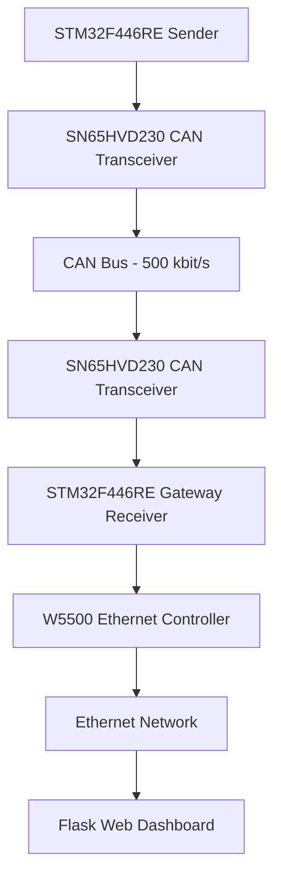

# STM32 CAN-Ethernet Diagnostic Gateway for Vehicle Parameter Monitoring

An STM32F4-based diagnostic gateway that collects vehicle-related parameters through CAN communication and transfers the received data over Ethernet for monitoring through a web dashboard.

## 1. Project Overview

This project implements a CAN-to-Ethernet diagnostic gateway using STM32F446RE Nucleo development boards.

The system consists of two STM32 nodes:

- **CAN Sender:** Simulates a vehicle-side ECU, reads sensor data and demonstration parameters, and transmits them over the CAN bus.
- **Gateway Receiver:** Receives CAN messages, processes the data, monitors data freshness, and forwards the information through a W5500 Ethernet controller to a Flask-based web dashboard.

The prototype demonstrates communication between embedded nodes using CAN and Ethernet.

## 2. Project Objectives

- Establish CAN communication between two STM32F446RE boards.
- Configure CAN communication at 500 kbit/s.
- Interface environmental and temperature sensors.
- Implement interrupt-driven CAN message reception.
- Transfer received diagnostic data over Ethernet using the W5500 module.
- Monitor vehicle-related parameters through a web dashboard.
- Detect outdated data using timestamp-based timeout checks.

## 3. System Architecture



## 4. Hardware Components

| Component | Purpose |
|---|---|
| STM32F446RE Nucleo Board × 2 | CAN sender and gateway receiver |
| SN65HVD230 CAN Transceiver × 2 | CAN physical-layer communication |
| BMP280 | Temperature and atmospheric pressure measurement |
| DS18B20 | Temperature measurement |
| W5500 Ethernet Module | Ethernet communication through SPI |
| Potentiometer | Demonstration speed and RPM input |

## 5. CAN Communication Protocol

The two STM32 boards communicate using Classical CAN.

**Communication configuration**

| Parameter | Configuration |
|---|---|
| CAN Peripheral | bxCAN |
| CAN Bitrate | 500 kbit/s |
| CAN Clock | 45 MHz |
| Prescaler | 18 |
| BS1 | 2 TQ |
| BS2 | 2 TQ |
| Total Time Quanta | 5 TQ |

**CAN Message IDs**

| CAN ID | Data |
|---|---|
| `0x100` | BMP280 temperature and pressure |
| `0x101` | DS18B20 temperature |
| `0x102` | Demonstration vehicle speed and RPM |

The receiver uses CAN FIFO0 interrupt-based reception and message filtering to process incoming frames.

## 6. CAN Bitrate Calculation

The CAN bit timing is configured using the following equation:

The CAN bit timing is configured using the following equation:

$$
\text{Bitrate} = \frac{\text{CAN Clock}}{\text{Prescaler} \times \text{Total TQ}}
$$

For the implemented configuration:

$$
\text{Bitrate} = \frac{45\,\text{MHz}}{18 \times 5}
$$

Therefore,

$$
\boxed{\text{Bitrate} = 500\,\text{kbit/s}}
$$

Each CAN bit consists of:

- Synchronization Segment: 1 TQ
- BS1: 2 TQ
- BS2: 2 TQ

## 7. Firmware Implementation

### CAN Sender

The sender firmware is responsible for:

- Reading BMP280 sensor measurements through I2C.
- Reading DS18B20 temperature through 1-Wire communication.
- Generating demonstration speed and RPM values using an ADC potentiometer.
- Packing parameter values into CAN data frames.
- Transmitting data using the configured CAN identifiers.

### CAN Gateway Receiver

The receiver firmware performs:

- Interrupt-driven CAN message reception.
- CAN identifier filtering and payload decoding.
- Sensor data processing.
- Timestamp-based stale-data detection.
- W5500 Ethernet communication through SPI.
- HTTP POST transmission of JSON data to the Flask dashboard.
- Ethernet link monitoring and connection retry handling.

## 8. Ethernet Communication

The W5500 Ethernet controller is interfaced with the STM32 through SPI.

The gateway formats the received parameters as JSON and sends them to the Flask dashboard using HTTP POST requests.

The configured data transmission interval is approximately 2 seconds.

## 9. Data Freshness Monitoring

The gateway uses timestamp-based timeout checks to identify outdated data.

| Parameter | Timeout |
|---|---:|
| CAN/BMP280 data | 5 seconds |
| DS18B20 temperature | 5 seconds |
| Speed/RPM data | 2 seconds |

This helps the gateway identify communication interruptions and avoid treating old readings as fresh data.

## 10. Experimental Setup and Results

### 10.1 Hardware Implementation

The prototype was implemented using two STM32F446RE Nucleo development boards connected through SN65HVD230 CAN transceivers.


*Figure 1. Physical hardware implementation of the CAN-Ethernet diagnostic gateway.*

### 10.2 Real-Time Dashboard

The gateway forwards received diagnostic parameters through the W5500 Ethernet controller to a Flask-based web dashboard.


*Figure 2. Real-time vehicle parameter monitoring dashboard.*

## 11. Limitations

- The prototype uses an STM32 sender to simulate a vehicle-side ECU.
- Speed and RPM are demonstration values generated using an ADC potentiometer, not measurements from an actual vehicle.
- Fuel and battery voltage values are placeholders.
- The prototype has not been integrated with an actual vehicle ECU.

## 12. Future Improvements

- Integration with an actual vehicle ECU.
- Support for additional diagnostic parameters.
- Implementation of automotive diagnostic protocols.
- Improved communication fault handling.
- Addition of authentication and secure communication.

## 13. Technologies Used

- Embedded C
- STM32F446RE
- STM32 HAL
- CAN / bxCAN
- I2C
- SPI
- 1-Wire
- W5500 Ethernet Controller
- HTTP
- JSON
- Python Flask
- STM32CubeIDE

## 14. Repository Structure

```text
STM32-CAN-Ethernet-Diagnostic-Gateway/
│
├── Firmware/
│   ├── Gateway_Receiver/
│   │   └── Core/
│   │       ├── Inc/
│   │       └── Src/
│   │
│   └── CAN_Sender/
│       └── Core/
│           ├── Inc/
│           └── Src/
│
└── README.md
```

---

**Developed as a final-year engineering major project.**
